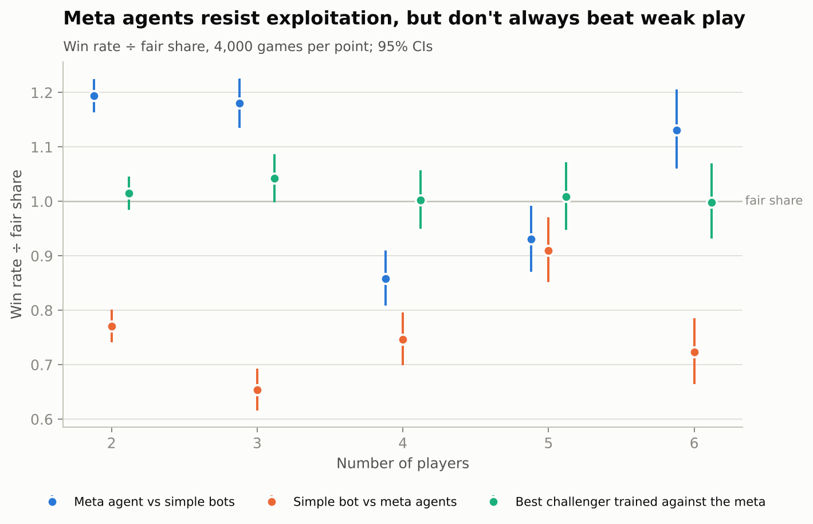
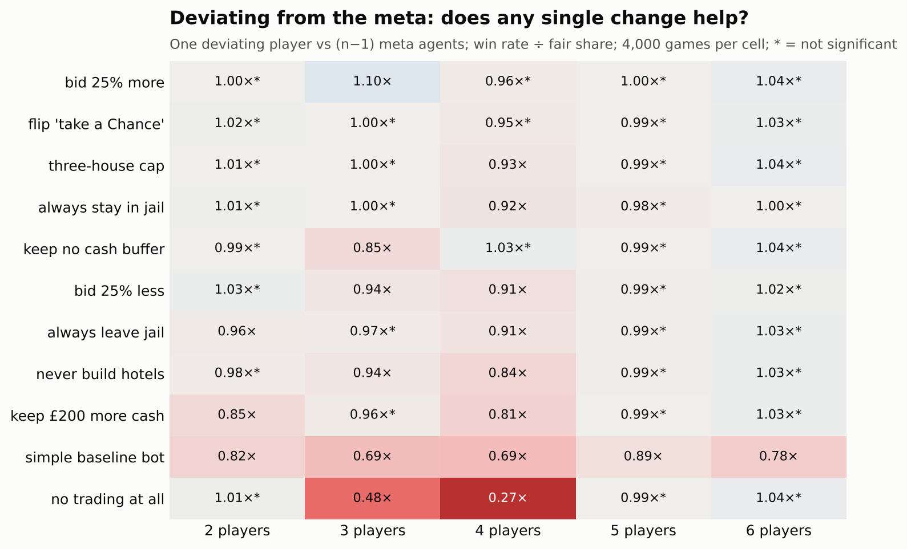

# Monopoly Meta

**Finding the meta in classic UK Monopoly at every table size from 2 to 6 players. The
project combines exact probability, a full-rules simulator, Monte Carlo tournaments,
self-play meta agents and game-state valuation.**

Monopoly is a property-investment game, so this project treats it like one. Each property
gets a landing rate, a rent yield and a payback period. Every decision (buy, bid, build,
trade, sit in jail) is scored by how much it changes your **probability of winning**.
The end goal is a model that prices any property or trade *in the current game state*,
for example (illustrative figures): "Vine Street is worth £640 to you right now, £180 to
Player 3."

Every result covers **2 to 6 players**, the largest table that official championship
scoring allows. Strategies are tested against **meta agents found by self-play**, not only
against hand-written bots.

> **Work in progress (v0.3).** The engine, the analyses and the dashboard are done and tested. The
> meta-agent sections below still describe an earlier version (stalled games scored as draws); they
> will be rewritten once the current runs finish: official rules with stalled games scored as a loss
> for everyone, plus an official championship mode with the Speed Die. Next comes a Rust engine and
> learned value models ([ROADMAP.md](ROADMAP.md)).

---

## Headline findings

### Holds at every table size

**1. Where the dice take you.** Trafalgar Square is the most-landed property, at
**3.48 landings per 100 turns**. Next come Marlborough Street and Marylebone Station (3.28
each), then Vine Street (3.25). Park Lane is the least-landed property (2.36). Landing rates
are per turn, so they don't depend on the number of players. Players spend **11%** of their
turns in Jail if they roll for doubles, and **4.7%** if they pay straight out. When
opponents leave Jail quickly, Marylebone and Vine Street get about **12% more** traffic.


**2. Orange pays back fastest, and the third house is the best buy.** With hotels, the
orange set repays the whole investment (set + buildings) faster than any other set. In
every group except brown, the third house earns the best return of any building level.
Payback time scales with 1/(number of opponents), so the ranking is the same at every
table size and only the speed changes:

| Players | Orange with hotels | Green with hotels |
|---|---|---|
| 2 | 22.1 rounds | 35.0 rounds |
| 3 | 11.0 | 17.5 |
| 4 | 7.4 | 11.7 |
| 5 | 5.5 | 8.8 |
| 6 | 4.4 | 7.0 |


**3. Valuing a property in pounds underprices it.** In the trade test below, the buyer's
true maximum price (where their win chance stops improving) is well above the maximum
implied by expected net worth. The gap is **24% at 2 players, 30% at 3 and 41% at 4**. At
5–6 players it's at least 38–42%: the buyer still gains at £1,200, all the cash they have,
so the true maximum is higher still. Completing a set is worth much more than the rent it
brings in.

### Changes with table size

**4. Trades are zero-sum with 2 players. With more, a deal zone opens and widens.** Take
a game ten rounds in: Player 0 owns two oranges, Player 1 owns Vine Street, and every other
player is a bystander holding four unrelated properties. The rollout evaluator plays the
position 2,000 times per price. Each "sell" rollout is paired with a "keep" rollout that
uses the same dice (common random numbers).

| Players | Seller's break-even | Buyer's maximum | Deal zone |
|---|---|---|---|
| 2 | £659 | £659 | none: one player's gain is exactly the other's loss |
| 3 | £675 | £895 | £675–£895 |
| 4 | £599 | £1,171 | £599–£1,171 |
| 5 | £515 | £1,200+ | the buyer should pay every penny they have |
| 6 | £450 | £1,200+ | the buyer should pay every penny they have |

The extra room comes from the bystanders. Every deal in the zone takes win probability
away from the players who aren't trading. Selling Vine Street to a player who *doesn't*
need it barely matters at any table size (break-even £25–£71).


**5. Against simple bots, aggression and trading pay off more as the table grows.** Each
tweak to the simple bot played 10,000 games at each table size against copies of the
simple bot:

- **Aggressive (no cash buffer, auction bids up to 120% of face value):** 1.00× its fair
  share at 2 players, rising to **1.38×** at 6.
- **Never proposing trades:** the *best* tweak at 2 players (1.12×, since trades there are
  zero-sum) and among the worst at 6 (**0.25×**).
- **Cautious (£400 cash buffer, auction bids up to 80% of face value):** 0.87× at 2
  players, falling to 0.62× at 6.
- **Random decisions:** about even at 2 players (0.98×) but **0.01×** at 6. Skill matters
  more as the table grows.


**6. Going first matters more at bigger tables.** With identical bots, the first player
wins 1.02× their fair share at 2 players (not significant), 1.09× at 4 and **1.23×** at 6.
The last player wins only 0.77× at 6.


**7. Games get shorter (in rounds) with more players.** The median game lasts 63 rounds
with 2 players and 35 with 6. A Free Parking jackpot shortens games at every table size,
most at 2 players (56.5 rounds instead of 63).


### Against meta agents (self-play)

The simple bots are a weak benchmark, so I also evolved a **meta agent for each table
size**:

- **The bot.** About 20 tunable settings: cash buffers, auction limits, the premium for
  completing or blocking a set, building caps, jail policy, trade offer and ask prices, and
  a buying weight for each colour group.
- **Evolution.** Candidates play thousands of games against the current population and a
  hall of fame of past champions. The winners are kept and mutated, for 12 generations.
- **Hardening.** A fresh challenger is trained to beat the meta agent. Whenever it wins by
  5% or more, it joins the opponent pool permanently and evolution continues. This is a
  small version of the double-oracle / PSRO method used for game-playing AI.
- **Time limit.** Games stop after 150 rounds, and a stopped game counts as a draw between
  the players still in it.

| | 2 players | 3 | 4 | 5 | 6 |
|---|---|---|---|---|---|
| Best challenger before hardening | 1.00× | 1.08× | 1.03× | **2.19×** | **2.52×** |
| Best challenger after hardening | **1.02×** | **1.04×** | **1.00×** | **1.01×** | **1.00×** |
| Meta agent vs simple bots | 1.19× | 1.18× | 0.86× | 0.93× | 1.13× |
| Simple bot vs meta agents | 0.77× | 0.65× | 0.75× | 0.91× | 0.72× |

(Win rate ÷ fair share, 4,000 games each; 95% CIs are about ±0.03 at 2 players and about
±0.07 at 6. The "before" row is the hardening stage's own measurement. The first pass
measured the same matchup on a different random seed and got 1.03× at 3 players and 2.25×
at 5, a reminder of the noise at this sample size.)

**8. After hardening, no challenger in this bot design can beat the meta agents.** The
best challenger reaches 1.00–1.04× its fair share at every table size, all within
noise.

**9. The best strategy against strong players isn't always best against weak ones.** The
4- and 5-player meta agents lose slightly to the simple bots (0.86× and 0.93×), even
though the simple bot loses to them (0.75× and 0.91×). Win rates aren't transitive, so a
strategy only means something relative to who it's played against. That's why this
project reports both.

**10. What the meta agents agree on** (single changes to the meta agent, each played
against copies of it):

- **Trade at 3–4 players.** Removing trading leaves the meta agent with **0.48×** its fair
  share at 3 players and **0.27×** at 4. At 2 players it doesn't matter (1.01×): two-player
  trades are zero-sum, and the 2-player meta never proposes one.
- **Don't sit on cash.** Keeping £200 more in reserve costs 15–19% of wins at 2 and 4
  players. All five meta agents keep a building reserve of £137 or less.
- **Build to hotels.** Stopping at four houses costs 6% of wins at 3 players and 16% at 4.
- **Bid above face value at bigger tables.** The 4–6 player agents bid up to 132–145% of
  a property's price at auction.
- **Small decisions are small.** Changing the jail policy, the "£10 fine or take a Chance"
  choice or adding a three-house cap moves win rates by at most 9%, and most of those
  changes aren't significant.

**11. With 5–6 players, self-play settles into a trade embargo.** The first-pass 5- and
6-player agents would sell a set-completing piece if paid their asking price (about 3×
face value), and a challenger learned to exploit that. It paid the asking price for the
pieces it needed, never sold anything back, and won **2.2–2.5×** its fair share. Hardening fixed this the only way this bot design
allows: the final agents **accept no trades at all**. With nobody accepting, about 80% of
games between meta agents run to the time limit as draws. No single player can do better
by changing strategy, so the embargo is stable.

Under the embargo, selling Vine Street to complete someone's set ends the stalemate in the
buyer's favour, and **no price compensates the seller**. The rollouts with simple bots show
that mutually beneficial deals do exist at 5–6 players. The agents switch acceptance off
only because their rule-of-thumb acceptance can't tell a fair deal from an exploitative
one. A value-model trader that accepts only deals inside the real deal zone is the next
step on the roadmap.

A side note on scoring: an earlier version used championship-style scoring, where the
richest player wins when time runs out. Under that rule, 5-player self-play learned to
refuse every trade and coast to the time limit (77% of its games; see `stall_check.csv` in the archive). The archived agents
are in `results/tables/archive_networth_cap/`.




**The meta agents, in their own settings** (only settings that measurably matter are worth
reading closely; the rest drift freely during evolution):

| | 2 players | 3 | 4 | 5 | 6 |
|---|---|---|---|---|---|
| Cash kept after buying / after building | £0 / £63 | £345 / £43 | £109 / £137 | £0 / £70 | £19 / £64 |
| Auction limit (× face value) | 1.20 | 0.85 | 1.32 | 1.42 | 1.45 |
| Proposes trades / accepts trades | no / yes | yes / yes | yes / yes | yes / **no** | yes / **no** |
| Cash offered / asked for a set-completing piece (× face) | 1.95 / 1.29 | 1.52 / 1.00 | 2.56 / 2.27 | 3.74 / 2.93 | 3.19 / 2.53 |
| Builds evenly up to | 4 houses first | 3 houses first | hotels | hotels | hotels |
| Jail | roll for doubles | roll for doubles | leave early, stay late | leave early, stay late | leave early, stay late |


---

## How it works

```
data/uk_classic.json ──► edition.py ──► engine.py  (full-rules simulator, seeded, restartable)
                                     ├► markov.py  (exact 123-state chain) ──► roi.py
                                     ├► policies.py (parameterised bots)
                                     ├► tournament.py (seat-rotated games, Wilson CIs)
                                     ├► rollout.py (paired rollouts, trade price curves)
                                     └► meta.py (evolutionary self-play, exploitability, hardening)
```

- **Rules**: classic UK board and cards, with auctions, mortgages, even building, the
  32-house / 12-hotel limit, Jail and bankruptcy. Card decks run in a fixed order, as in
  the real game. Everything is listed, with sources and simplifications, in
  [RULES.md](RULES.md).
- **Validation**: the exact Markov chain is checked against 10M simulated turns per
  setting. When cards are drawn with replacement (the chain's assumption), every square
  matches to within **0.5%**. Real fixed decks shift a few card-destination squares by up
  to 1.8% while someone is holding a Get Out of Jail Free card.
- **Tests**: 71 `pytest` tests:
  - rule-by-rule checks with scripted dice;
  - invariant checks after every turn of 160 full games under four rule sets (house
    supply, even building, deck integrity, no negative cash);
  - Markov vs simulation checks;
  - common-random-number reproducibility and dice-alignment checks;
  - scenario and zero-sum checks at every table size;
  - meta-search checks (mutation bounds, paired evaluation, evolution, hardening);
  - regression tests for the defects an independent code review found.
- **Speed**: about 2–4 ms per full game in pure Python, depending on table size.

## Quick start

```bash
pip install -e ".[dev]"
pytest
python scripts/01_markov.py              # landing probabilities + validation (~1 min)
python scripts/02_roi.py                 # property economics, 2-6 players
python scripts/03_tournament.py          # seat advantage, strategy tweaks, house rules (~20 min)
python scripts/04_trade_curve.py         # trade price curves, 2-6 players (~9 min)
python scripts/05_meta_agents.py         # evolve meta agents by self-play (~1 h, checkpointed)
python scripts/05b_refine_meta.py        # harden them against best responses (~2-3 h, checkpointed)
python scripts/06_meta_trade_curve.py    # re-value the trade under meta play (~10 min)
python scripts/make_figures.py           # all charts -> results/figures
```

```python
from monopoly_meta import Game
from monopoly_meta.policies import make_bot

result = Game([make_bot("aggressive"), make_bot("balanced"), make_bot("cautious")], seed=1).play()
print(result.winner, result.turns)
```

## Limitations

- The meta agents are the best strategies found **within the heuristic bot design**:
  about 20 parameters covering buying, bidding, building, jail and trading. They are not
  provably optimal play. The roadmap's value-model agents remove that limit.
- Bot trading uses simple rules (set-completing swaps, and cash offers at a multiple of
  face value). Richer negotiation comes with the value model.
- Meta-agent games stop after 150 rounds, and a stopped game counts as a draw between the
  players still in it. At 5–6 players most games between meta agents end this way (the
  trade embargo above).
- The rollout valuer is exact but slow (about 1 minute per price curve). The learned value
  model in Phase 3 makes it instant.

## Repository

```
src/monopoly_meta/   engine, Markov chain, ROI, bots, tournaments, rollouts, meta search
src/monopoly_meta/data/uk_classic.json   board, rents and cards (with sources)
scripts/             reproducible pipeline 01 → 06, figures
results/tables       every number quoted above, as CSV/JSON (meta/ holds per-table-size checkpoints)
results/figures      every chart above
tests/               unit, invariant, statistical and regression tests
```

## Disclaimer

An independent, unofficial analysis for learning and research. Not affiliated with or endorsed by
Hasbro. MONOPOLY is a trademark of Hasbro; board names, prices and card texts are used here only to
model the game.

## Licence

Code: [MIT](LICENSE).
