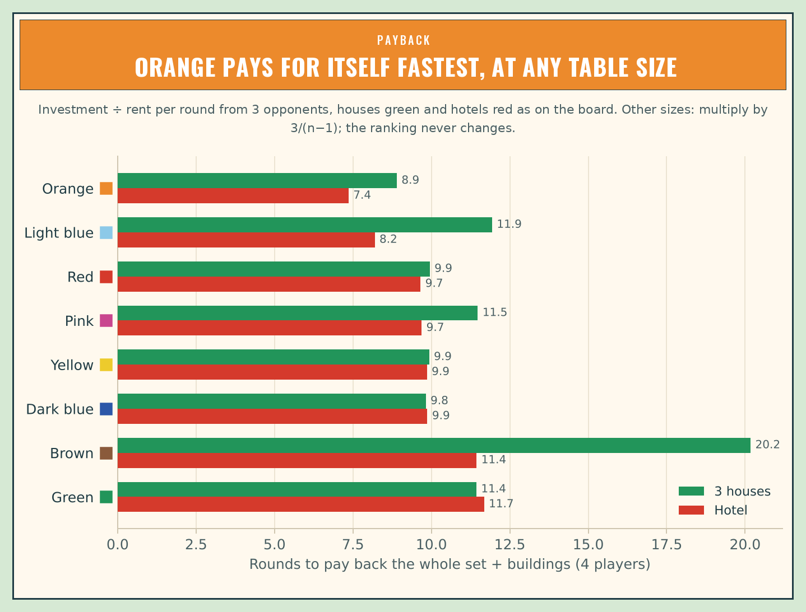
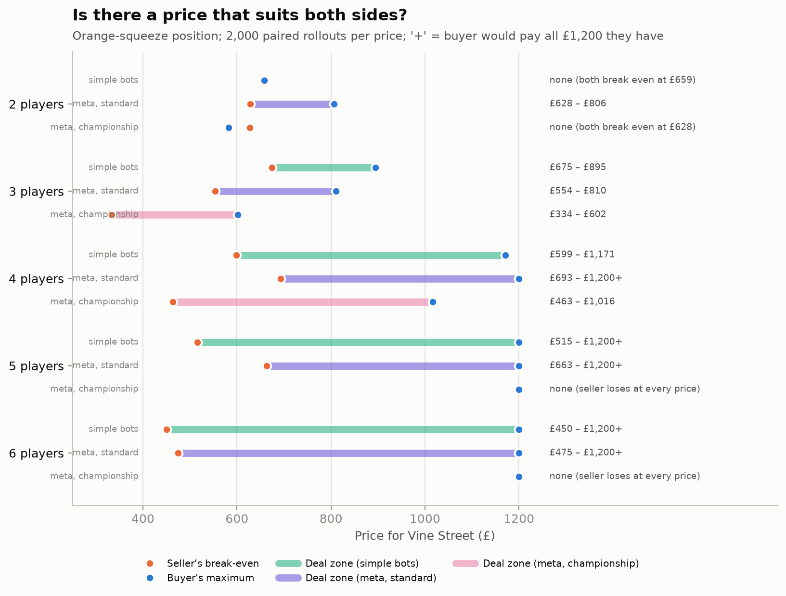
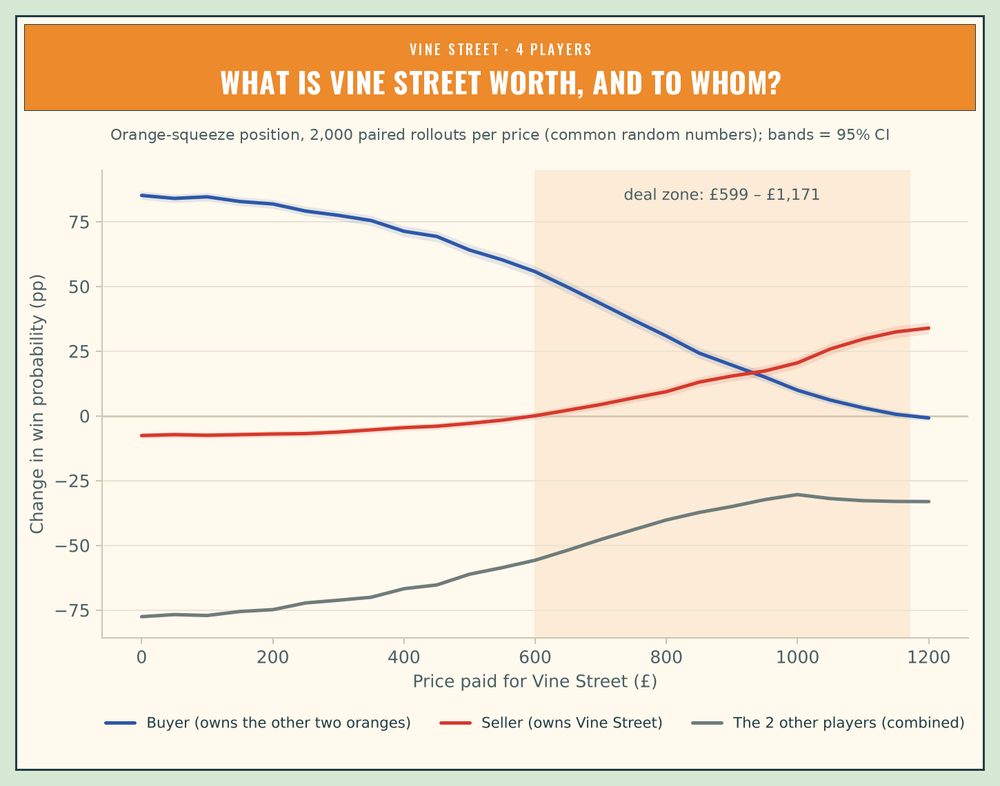
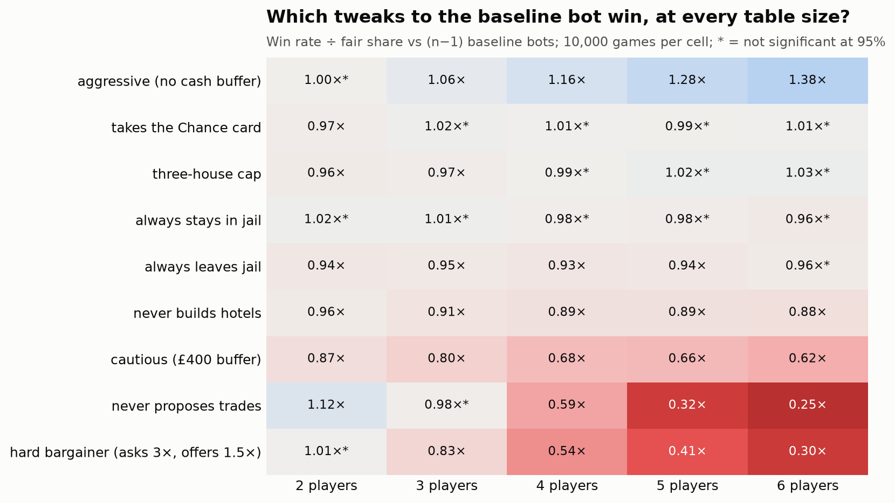
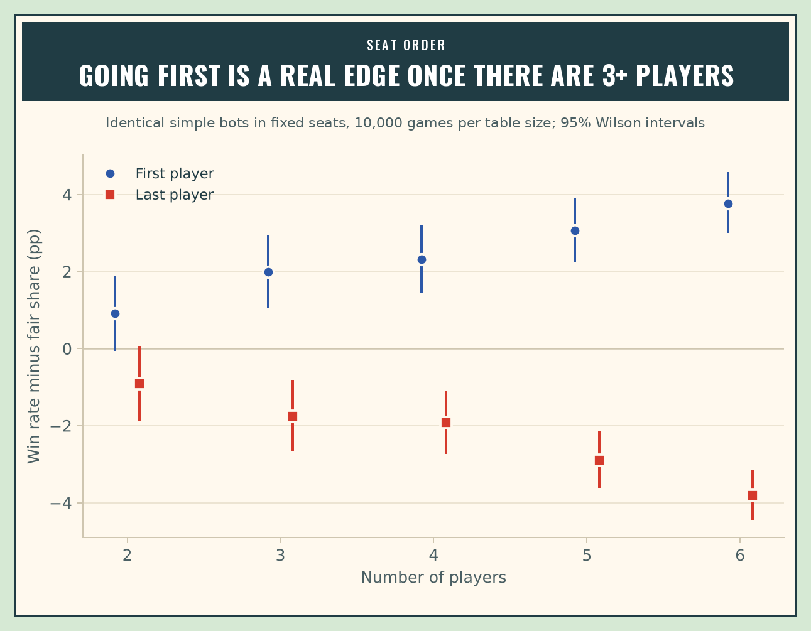
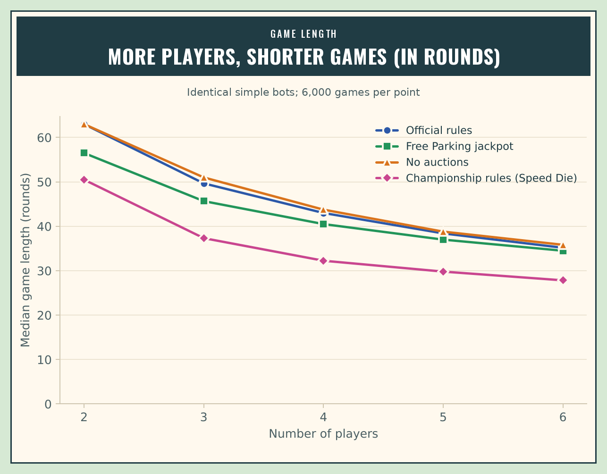

# Monopoly Meta

**Finding the meta in classic UK Monopoly at every table size from 2 to 6 players. The
project combines exact probability, a full-rules simulator, Monte Carlo tournaments,
self-play meta agents and game-state valuation.**

Monopoly is a property-investment game, so this project treats it like one. Each property
gets a landing rate, a rent yield and a payback period. Every decision (buy, bid, build,
trade, sit in jail) is scored by how much it changes your **probability of winning**.
The end goal is a model that prices any property or trade *in the current game state*,
for example (illustrative figures): "Vine Street is worth £640 to you right now, £180 to
Player 3."

Every result covers **2 to 6 players**, the largest table that official championship
scoring allows. Strategies are tested against **meta agents found by self-play**, not only
against hand-written bots.

> **Status (v0.5).** The engine, the analyses and the meta agents are done and tested, including v0.4's search
> for unconventional strategies and v0.5's hardening against them. A live viewer replays games from running jobs
> (`make watch`), and you can play the meta agents yourself (`make play`). The deep run is re-measuring every study
> at 10 times the samples with the final agents (`results/final`); its tables will replace the remaining
> v0.3-era figures. Next come a Rust engine and learned value models ([ROADMAP.md](ROADMAP.md)).

---

## Headline findings

### Holds at every table size

**1. Where the dice take you.** Trafalgar Square is the most-landed property, at
**3.48 landings per 100 turns**. Next come Marlborough Street and Marylebone Station (3.28
each), then Vine Street (3.25). Park Lane is the least-landed property (2.36). Landing rates
are per turn, so they don't depend on the number of players. Players spend **11%** of their
turns in Jail if they roll for doubles, and **4.7%** if they pay straight out. When
opponents leave Jail quickly, Marylebone and Vine Street get about **12% more** traffic.


**2. Orange pays back fastest, and the third house is the best buy.** With hotels, the
orange set repays the whole investment (set + buildings) faster than any other set. In
every group except brown, the third house earns the best return of any building level.
Payback time scales with 1/(number of opponents), so the ranking is the same at every
table size and only the speed changes:

| Players | Orange with hotels | Green with hotels |
|---|---|---|
| 2 | 22.1 rounds | 35.0 rounds |
| 3 | 11.0 | 17.5 |
| 4 | 7.4 | 11.7 |
| 5 | 5.5 | 8.8 |
| 6 | 4.4 | 7.0 |




**3. Valuing a property in pounds underprices it.** In the trade test below, the buyer's
true maximum price (where their win chance stops improving) is well above the maximum
implied by expected net worth. The gap is **24% at 2 players, 30% at 3 and 41% at 4**. At
5–6 players it's at least 38–42%: the buyer still gains at £1,200, all the cash they have,
so the true maximum is higher still. Completing a set is worth much more than the rent it
brings in.

### Changes with table size

**4. Trades are zero-sum with 2 players. With more, a deal zone opens and widens.** Take
a game ten rounds in: Player 0 owns two oranges, Player 1 owns Vine Street, and every other
player is a bystander holding four unrelated properties. The rollout evaluator plays the
position 2,000 times per price. Each "sell" rollout is paired with a "keep" rollout that
uses the same dice (common random numbers).

| Players | Seller's break-even | Buyer's maximum | Deal zone |
|---|---|---|---|
| 2 | £659 | £659 | none: one player's gain is exactly the other's loss |
| 3 | £675 | £895 | £675–£895 |
| 4 | £599 | £1,171 | £599–£1,171 |
| 5 | £515 | £1,200+ | the buyer should pay every penny they have |
| 6 | £450 | £1,200+ | the buyer should pay every penny they have |

The extra room comes from the bystanders. Every deal in the zone takes win probability
away from the players who aren't trading. Selling Vine Street to a player who *doesn't*
need it barely matters at any table size (break-even £25–£71).




**5. Against simple bots, aggression and trading pay off more as the table grows.** Each
tweak to the simple bot played 10,000 games at each table size against copies of the
simple bot:

- **Aggressive (no cash buffer, auction bids up to 120% of face value):** 1.00× its fair
  share at 2 players, rising to **1.38×** at 6.
- **Never proposing trades:** the *best* tweak at 2 players (1.12×, since trades there are
  zero-sum) and among the worst at 6 (**0.25×**).
- **Cautious (£400 cash buffer, auction bids up to 80% of face value):** 0.87× at 2
  players, falling to 0.62× at 6.
- **Random decisions:** about even at 2 players (0.98×) but **0.01×** at 6. Skill matters
  more as the table grows.



**6. Going first matters more at bigger tables.** With identical bots, the first player
wins 1.02× their fair share at 2 players (not significant), 1.09× at 4 and **1.23×** at 6.
The last player wins only 0.77× at 6.



**7. Games get shorter (in rounds) with more players.** The median game lasts 63 rounds
with 2 players and 35 with 6. A Free Parking jackpot shortens games at every table size,
most at 2 players (56.5 rounds instead of 63).



### Against meta agents (self-play)

The simple bots are a weak benchmark, so every table size has a **meta agent found by self-play**, under two
rule sets:

- **Official rules,** with a 150-round limit. A game stopped by the limit counts as a loss for everyone, so
  stalling never pays.
- **Championship rules** (Hasbro's 2009 tournament rules): the Speed Die, no trades once two players are left,
  an auction nobody bids in goes to the richest player for £1, and finishing-position points at the limit.

Each agent is a heuristic bot with about 20 settings: cash buffers, auction limits, set and blocking premiums,
building caps, jail policy, trade prices and a buying weight per colour group. It is evolved by self-play, then
hardened against best responses, a small version of the double-oracle / PSRO method used for game-playing AI.

**8. Every v0.3 meta agent can be beaten, by 1.2 to 1.9 times its fair share.** v0.4 gave the bot eight
optional moves people rarely make:

- forcing an auction when every rival is short of cash;
- hoarding houses so rivals can't build;
- borrowing against lone properties to build;
- sitting in jail by the numbers;
- dodging dangerous squares with the Speed Die;
- counting cards;
- charging the leader more;
- playing the clock.

Two searches then looked for strategies that beat the meta agents. A best-response search ran with and without
the new moves, on the same budget. A MAP-Elites search kept the best strategy of each style rather than one
winner. The strongest MAP-Elites finds, re-measured on 10,000 fresh games:

| Players | Official rules | Championship rules |
|---|---|---|
| 2 | 1.88× | 1.58× |
| 3 | 1.48× | 1.89× |
| 4 | 1.71× | 1.65× |
| 5 | 1.44× | 1.40× |
| 6 | 1.52× | 1.21× |

(Win credit ÷ the meta agent's own credit in that seat, on the same games; 95% intervals about ±0.03 to ±0.06.
Details: [results/v04/tables/unconventional/summary.md](results/v04/tables/unconventional/summary.md).)

**9. Two new moves do most of the work: borrowing to build and the housing lock.** Each move was switched off in
turn in v0.4's strongest finds, on 6,000 paired games each:

| Move | Strategies using it | Switching it off costs 0.05× or more | Average change |
|---|---|---|---|
| Borrowing to build | 25 | 13 | −0.107× |
| Housing lock | 30 | 13 | −0.057× |
| Auction sniping | 28 | 5 | −0.026× |
| Card counting | 23 | 6 | −0.026× |
| Dodging | 16 | 1 | −0.011× |
| Taxing the leader | 10 | 0 | −0.003× |
| Jail by the numbers | 6 | 0 | −0.001× |
| Playing the clock | 13 | 0 | 0.000× |

The housing lock means stopping at four houses while the bank is short and a rival still needs houses for a set.
It is the classic housing-shortage play, and the search found it with no hints. The other moves mostly ride along.
At 4 players, the strongest finds keep most of their edge with every new move off (1.45–1.56×). The v0.3
agents were beatable mainly through ordinary settings: what to buy and how fast to build.

**10. Many finds are counter-strategies, not a new meta.** A table made only of one find often collapses: the
finds hoard cash and skip whole colour groups, so whoever joins collects the auctions and those sets. At 5 and
6 players under championship rules, a single meta agent joining such a table wins 87–97% of games. So a league
of single-strategy tables overstates how easy each strategy is to beat, and v0.5 hardens at mixed tables instead.

**11. Hardening with the new moves (v0.5) fixed six of the ten agents, most clearly at 2 and 4 players.** Each
agent was hardened in up to four rounds:

- evolution at mixed tables that include every exploit found so far;
- keeping the candidate those exploits beat by the least;
- a fresh MAP-Elites search for new exploits of it.

v0.4's two searches then ran again against the new agent, with the same budgets and seeds. The new agent replaced
the old one only where its worst measured exploit was smaller:

| Players | Official: worst exploit, v0.3 → v0.5 | Kept | Championship: worst exploit, v0.3 → v0.5 | Kept |
|---|---|---|---|---|
| 2 | 1.91× → **1.15×** | v0.5 | 1.58× → **1.04×** | v0.5 |
| 3 | 1.49× → 1.58× | v0.3 | 1.90× → **1.53×** | v0.5 |
| 4 | 1.71× → **1.29×** | v0.5 | 1.66× → **1.31×** | v0.5 |
| 5 | 1.51× → **1.14×** | v0.5 | 1.44× → 1.56× | v0.3 |
| 6 | 1.52× → 5.26× | v0.3 | 1.27× → 1.75× | v0.3 |

The new 2-player agents dominate the old ones. One v0.5 agent at a table of v0.3 agents scores 1.93× (official)
and 1.56× (championship); one v0.3 agent at a table of v0.5 agents scores only 0.43× and 0.39×. The new agents
also took up the moves that beat their predecessors. The official 2-player agent snipes auctions, locks houses
and borrows to build. The championship 4-player agent locks houses while 22 or fewer are left in the bank, and
borrows to build. (Details: [results/v05/tables/hardened/summary.md](results/v05/tables/hardened/summary.md).)

**12. In the other four settings, hardening goes in circles.** These are 3 and 6 players under official rules,
and 5 and 6 under championship rules. Each round's agent patched the last round's holes and opened new ones, and
fresh searches beat it by more than they beat the old agent. At 6 players under official rules, the rounds made
things much worse (5.26×). These four settings keep their v0.3 agents. Training against a
weighted mixture of the strongest opponents, rather than a uniform pool, is the candidate fix.

The final agents' checks, single-setting changes and settings are being re-measured at 10 times the samples (the
deep run, `results/final`).

---

## How it works

```
data/uk_classic.json ──► edition.py ──► engine.py  (full-rules simulator, seeded, restartable)
                                     ├► markov.py  (exact 123-state chain) ──► roi.py
                                     ├► policies.py (parameterised bots)
                                     ├► tournament.py (seat-rotated games, Wilson CIs)
                                     ├► rollout.py (paired rollouts, trade price curves)
                                     ├► meta.py (evolutionary self-play, exploitability, hardening)
                                     ├► unconventional.py (eight new moves, MAP-Elites, leagues)
                                     ├► harden.py (best-response iteration against known exploits)
                                     ├► replay.py + watch/ (live viewer of a running job's games)
                                     └► human.py (play the meta agents yourself)
```

- **Rules**: classic UK board and cards, with auctions, mortgages, even building, the
  32-house / 12-hotel limit, Jail and bankruptcy. Card decks run in a fixed order, as in
  the real game. Everything is listed, with sources and simplifications, in
  [RULES.md](RULES.md).
- **Validation**: the exact Markov chain is checked against 10M simulated turns per
  setting. When cards are drawn with replacement (the chain's assumption), every square
  matches to within **0.5%**. Real fixed decks shift a few card-destination squares by up
  to 1.8% while someone is holding a Get Out of Jail Free card.
- **Tests**: 153 `pytest` tests:
  - rule-by-rule checks with scripted dice;
  - invariant checks after every turn of 160 full games under four rule sets (house
    supply, even building, deck integrity, no negative cash);
  - Markov vs simulation checks;
  - common-random-number reproducibility and dice-alignment checks;
  - scenario and zero-sum checks at every table size;
  - meta-search checks (mutation bounds, paired evaluation, evolution, hardening);
  - the new moves, MAP-Elites, resumable hardening, and playing a whole game as a person;
  - regression tests for the defects an independent code review found.
- **Speed**: about 2–4 ms per full game in pure Python, depending on table size.

## Quick start

```bash
pip install -e ".[dev]"
pytest
python scripts/01_markov.py              # landing probabilities + validation (~1 min)
python scripts/02_roi.py                 # property economics, 2-6 players
python scripts/03_tournament.py          # seat advantage, strategy tweaks, house rules (~20 min)
python scripts/04_trade_curve.py         # trade price curves, 2-6 players (~9 min)
python scripts/05_meta_agents.py         # evolve meta agents by self-play (~1 h, checkpointed)
python scripts/05b_refine_meta.py        # harden them against best responses (~2-3 h, checkpointed)
python scripts/06_meta_trade_curve.py    # re-value the trade under meta play (~10 min)
python scripts/make_figures.py           # all charts -> results/figures
```

The long searches (v0.4's unconventional strategies, v0.5's hardening, the deep run) are jobs for a 16-thread
PC: resumable, low priority, each one a `make` command ([RUNNING.md](RUNNING.md)). Two commands open a browser:

```bash
make watch    # a board replaying the running job's games, move by move, with live win chances
make play     # you against the meta agents: every decision a player makes, with an optional coach
```

```python
from monopoly_meta import Game
from monopoly_meta.policies import make_bot

result = Game([make_bot("aggressive"), make_bot("balanced"), make_bot("cautious")], seed=1).play()
print(result.winner, result.turns)
```

## Limitations

- The meta agents are the best strategies found **within the heuristic bot design**:
  about 20 settings covering buying, bidding, building, jail and trading, plus v0.4's eight
  optional moves. They are not provably optimal play. The roadmap's value-model agents
  remove that limit.
- Four meta agents are still v0.3's, because hardening went in circles there: 3 and 6
  players under official rules, 5 and 6 under championship rules. The strongest exploits
  found against them reach 1.27–1.52× a fair share.
- Bot trading uses simple rules (set-completing swaps, and cash offers at a multiple of
  face value). Richer negotiation comes with the value model.
- Meta-agent games stop after 150 rounds. Under official rules a stopped game is a loss
  for everyone; under championship rules it is scored by finishing position.
- The rollout valuer is exact but slow (about 1 minute per price curve). The learned value
  model in Phase 3 makes it instant.

## Repository

```
src/monopoly_meta/   engine, Markov chain, ROI, bots, tournaments, rollouts, meta search,
                     unconventional strategies, hardening, replays, play mode
src/monopoly_meta/data/uk_classic.json   board, rents and cards (with sources)
scripts/             reproducible pipeline 01 → 14, figures, the PC job runner and the viewer's server
results/tables       v0.3's numbers, as CSV/JSON (meta_<mode>/ holds per-table-size checkpoints)
results/v04          v0.4: exploitability and unconventional strategies (tables/unconventional/summary.md)
results/v05          v0.5: hardening and the meta agents kept (tables/hardened/summary.md)
results/final        the deep run: every study at 10x the samples with the final agents
results/figures      the charts above
watch/               the viewer and play mode (one page), with the board's artwork
tests/               unit, invariant, statistical and regression tests
```

## Disclaimer

An independent, unofficial analysis for learning and research. Not affiliated with or endorsed by
Hasbro. MONOPOLY is a trademark of Hasbro; board names, prices and card texts are used here only to
model the game.

## Licence

Code: [MIT](LICENSE).
