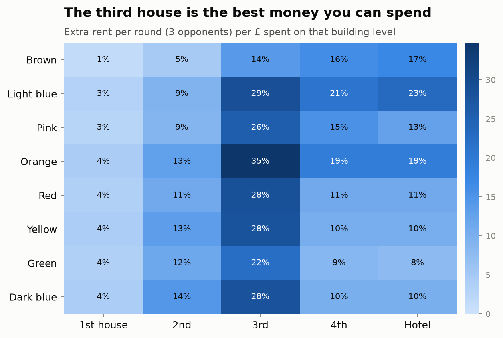
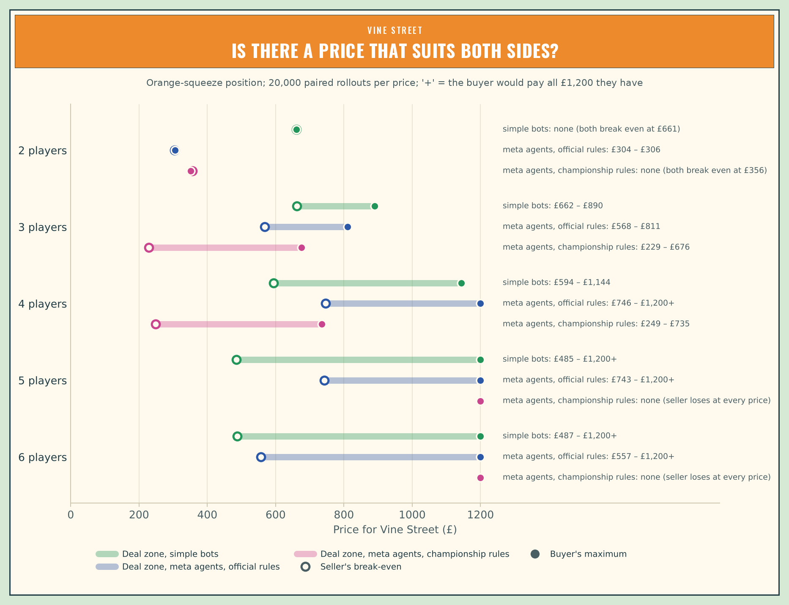
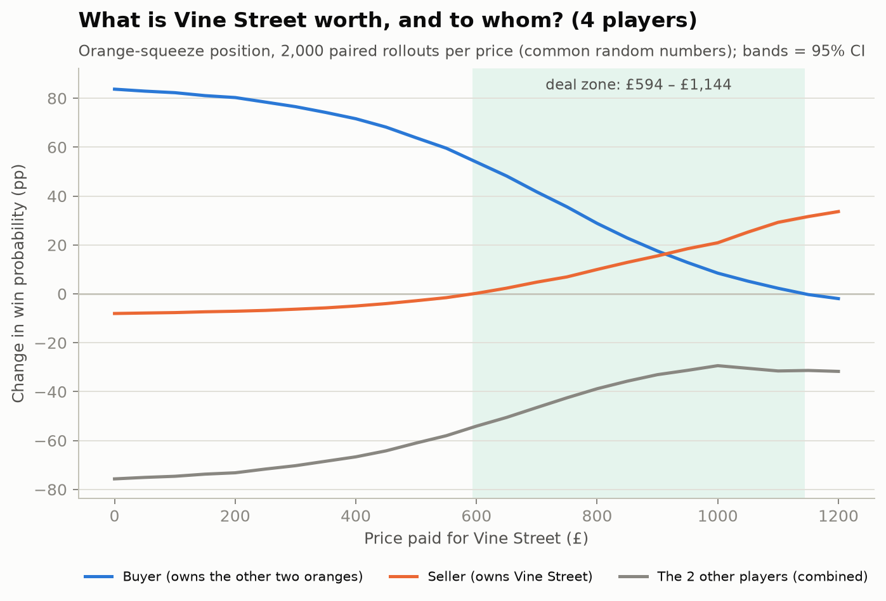
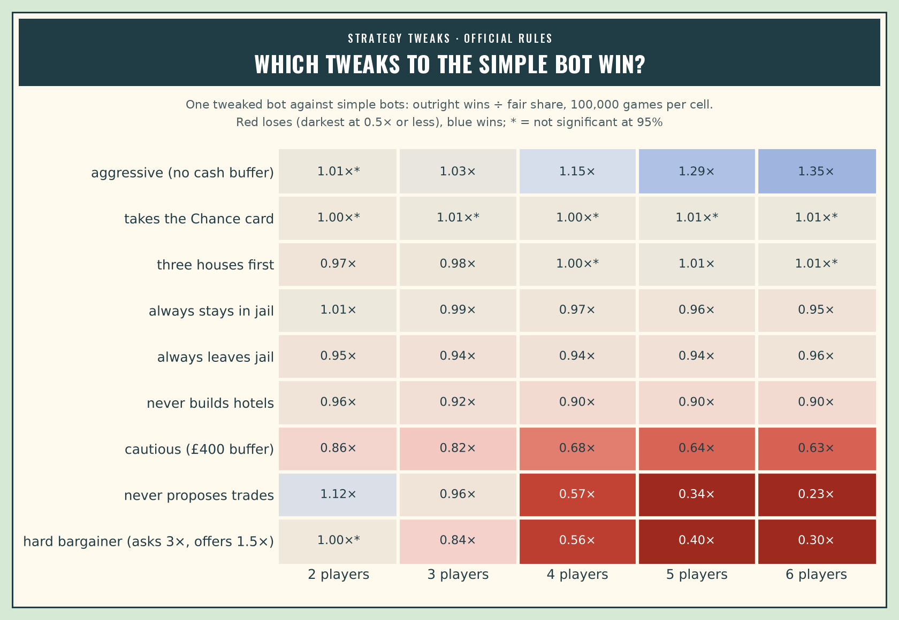
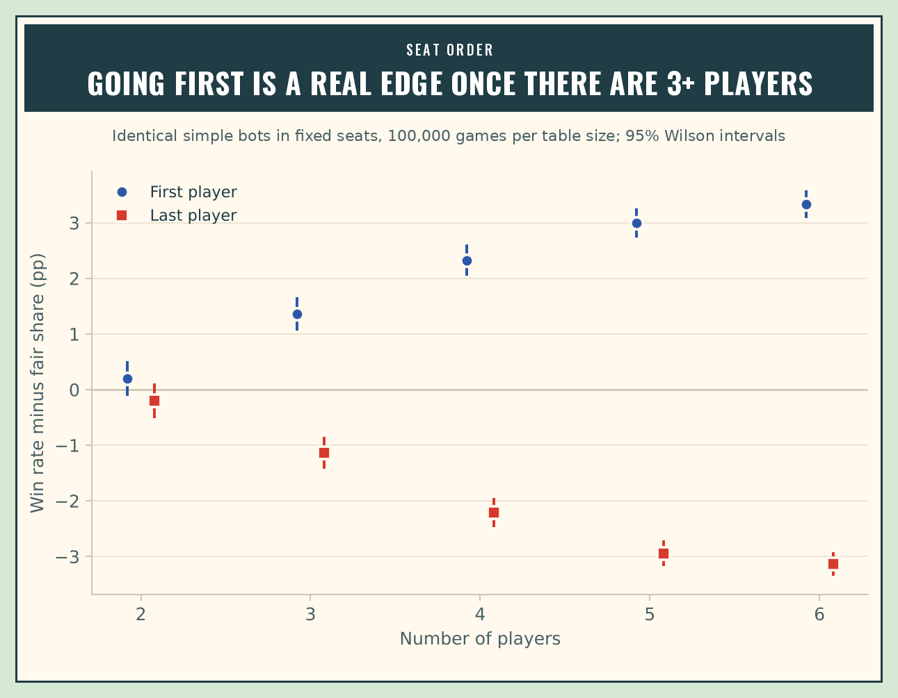
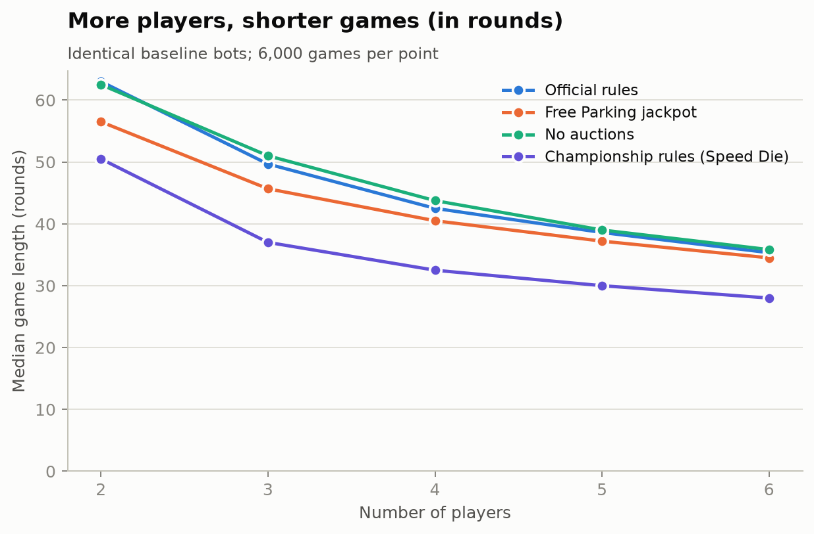
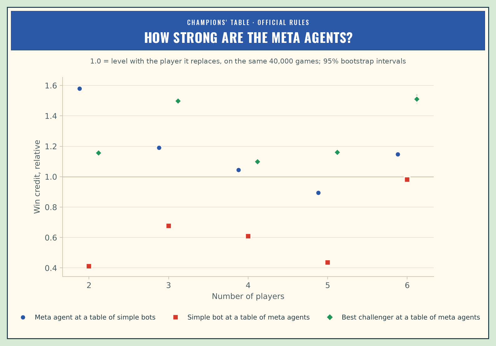
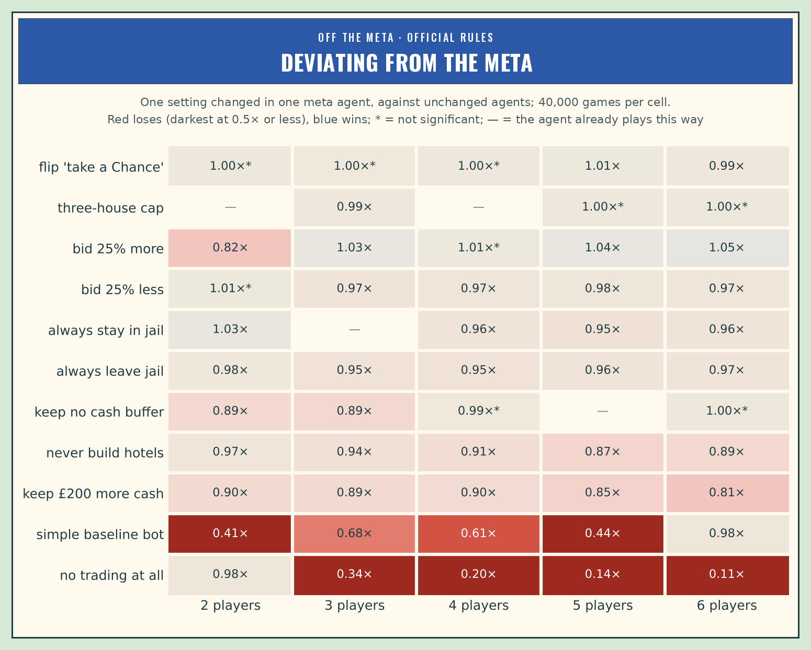
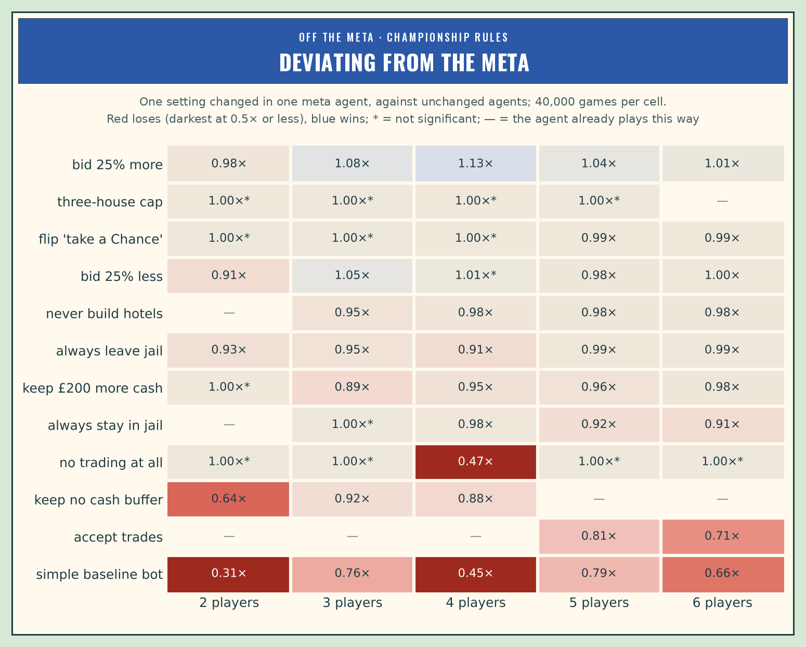

# Monopoly Meta

**Finding the meta in classic UK Monopoly at every table size from 2 to 6 players. The
project combines exact probability, a full-rules simulator, Monte Carlo tournaments,
self-play meta agents and game-state valuation.**

Monopoly is a property-investment game, so this project treats it like one. Each property
gets a landing rate, a rent yield and a payback period. Every decision (buy, bid, build,
trade, sit in jail) is scored by how much it changes your **probability of winning**.
The end goal is a model that prices any property or trade *in the current game state*,
for example (illustrative figures): "Vine Street is worth £640 to you right now, £180 to
Player 3."

Every result covers **2 to 6 players**, the largest table that official championship
scoring allows. Strategies are tested against **meta agents found by self-play**, not only
against hand-written bots.

> **Status (v0.5, corrected after an independent methodology review).** The engine, the analyses and the meta agents
> are done and tested, including v0.4's search for unconventional strategies and v0.5's hardening against them. The
> studies were then re-run with 10 times the samples, using the final agents (the deep run, `results/final`): a
> precision extension, since the first tenth of each sample is v0.3's games, and the exact Markov and payback tables
> were copied rather than re-run. The numbers and charts below come from it unless a finding says otherwise. An
> independent review (October 2026) found errors in how some results were summarised and labelled, and rules the
> engine simplifies. All are corrected below: the affected studies were re-run (`make review`), and the housing
> findings were re-tested under the official building rules (finding 18). A live viewer replays games from running
> jobs (`make watch`), and you can play the meta agents yourself (`make play`). Next come learned value models
> ([ROADMAP.md](ROADMAP.md)).

---

## Headline findings

### Holds at every table size

**1. Where the dice take you.** Trafalgar Square is the most-landed property, at
**3.48 landings per 100 turns** (exact for cards drawn with replacement; the real fixed decks
shift a few squares by up to 1.8%). Next come Marlborough Street and Marylebone Station (3.28
each), then Vine Street (3.25). Park Lane is the least-landed property (2.36). Landing rates
are per turn, so they don't depend on the number of players. Players spend **11%** of their
turns in Jail if they roll for doubles, and **4.7%** if they pay straight out. When
opponents leave Jail quickly, Marylebone and Vine Street get about **12% more** traffic.


**2. Orange pays back fastest, and the third house is the best buy.** With hotels, the
orange set repays the whole investment (set + buildings) faster than any other set. In
every group except brown, the third house earns the best return of any building level.
This is stationary gross-rent payback: the rent once everything is built, leaving out what
it costs to get the set and the turns spent building. Payback time scales with 1/(number of
opponents), so the ranking is the same at every table size by construction, and only the
speed changes:

| Players | Orange with hotels | Green with hotels |
|---|---|---|
| 2 | 22.1 rounds | 35.0 rounds |
| 3 | 11.0 | 17.5 |
| 4 | 7.4 | 11.7 |
| 5 | 5.5 | 8.8 |
| 6 | 4.4 | 7.0 |




**3. Net worth undervalues completing a set, by more the sooner you look.** In the trade
test below, the highest price at which the buyer's win chance still improves is well above
the highest price at which their net worth still improves. How far below, measured after the
same number of each player's own turns at every table size:

| Net worth measured after | 2 players | 3 | 4 | 5 | 6 |
|---|---|---|---|---|---|
| 5 own turns | 53% | 54% | 55% | ≥53% | ≥46% |
| 10 own turns | 41% | 37% | 39% | ≥36% | ≥27% |
| 20 own turns | 24% | 21% | 24% | ≥17% | ≥5% |

A set pays off over many turns, so a short horizon misses most of its value, and even after
20 rounds net worth misses a fifth to a quarter of it at 2–4 players. At 5–6 players the buyer
still gains at £1,200, all the cash they have, so those gaps are lower bounds. An earlier
version measured net worth after 40 player-turns, which is 20 rounds at 2 players but under
7 at 6, so the gap seemed to grow with the table size; at equal horizons it doesn't. Both
prices are for these bots in this one position.

### Changes with table size

**4. Trades are zero-sum with 2 players. With more, a deal zone opens and widens.** Take
a game ten rounds in: Player 0 owns two oranges, Player 1 owns Vine Street, and every other
player is a bystander holding four unrelated properties. The rollout evaluator plays the
position 20,000 times per price. Each "sell" rollout is paired with a "keep" rollout that
uses the same dice (common random numbers).

| Players | Seller's break-even | Buyer's maximum | Deal zone |
|---|---|---|---|
| 2 | £661 | £661 | none: one player's gain is exactly the other's loss |
| 3 | £662 | £890 | £662–£890 |
| 4 | £594 | £1,144 | £594–£1,144 |
| 5 | £485 | £1,200+ | the buyer should pay every penny they have |
| 6 | £487 | £1,200+ | the buyer should pay every penny they have |

A bootstrap over whole rollouts gives 95% intervals of ±£7–£13 for the 3- and 4-player
prices, and ±£17 and ±£40 for the 5- and 6-player break-evens.

The extra room comes from the bystanders. Every deal in the zone takes win probability
away from the players who aren't trading. Selling Vine Street to a player who *doesn't*
need it barely matters at any table size (break-even £41–£57).

These are prices for a one-shot sale with no resale (the property is frozen afterwards, in both
arms), to these bots, in one hand-built position per table size. Each extra player adds a
bystander with four properties, so the properties the bank still holds fall from 20 at 2
players to 4 at 6. The widening zone holds for this family of positions; positions drawn
from real games are the next test (ROADMAP.md).




**5. Against simple bots, aggression and trading pay off more as the table grows.** Each
tweak to the simple bot played 100,000 games at each table size against copies of the
simple bot:

- **Aggressive (no cash buffer, auction bids up to 120% of face value):** 1.01× its fair
  share at 2 players, rising to **1.35×** at 6.
- **Never proposing trades:** the *best* tweak at 2 players (1.12×, since trades there are
  zero-sum) and among the worst at 6 (**0.23×**).
- **Cautious (£400 cash buffer, auction bids up to 80% of face value):** 0.86× at 2
  players, falling to 0.63× at 6.
- **Random decisions:** about even at 2 players (0.98×) but **0.015×** at 6. Skill matters
  more as the table grows.

Under championship rules (60,000 games per cell), aggressive play also gains most at big tables (1.30× at 6
players), and never proposing trades also collapses there (0.31× at 6). At 2 players those rules ban trades, so not
proposing them changes nothing. Win rates here are outright wins, as a share of the games that finish. Under
championship rules 3–8% of 2-player games hit the time limit, and almost none at 4–6; counting the richest player in
those as the winner instead moves no number in this finding by more than 0.02.



**6. Going first matters more at bigger tables.** With identical bots (100,000 games per
table size), the first player wins 1.00× their fair share at 2 players (not significant),
1.09× at 4 and **1.20×** at 6. The last player wins only 0.81× at 6. Under championship
rules it's 1.09× and 1.19× for the first player at 4 and 6.



**7. With more players each player gets fewer turns, but the game has more of them.** The
median game lasts 63 rounds with 2 players and 35 with 6, where a round is the total number
of turns divided by the starting number of players: 126 turns in all at 2 players and 212 at
6. A Free Parking jackpot shortens games at every table size, most at 2 players (56.5 rounds
instead of 63). Championship rules, with the Speed Die, shorten them more: the median is
50.5 rounds at 2 players and 28 at 6.



### Against meta agents (self-play)

The simple bots are a weak benchmark, so every table size has a **meta agent found by self-play**, under two
rule sets:

- **Official rules,** with a 150-round limit. A game stopped by the limit counts as a loss for everyone, so
  stalling never pays.
- **Championship rules** (Hasbro's 2009 tournament rules): the Speed Die, no trades once two players are left,
  an auction nobody bids in goes to the richest player for £1, and finishing-position points at the limit.

Each agent is a heuristic bot with about 20 settings: cash buffers, auction limits, set and blocking premiums,
building caps, jail policy, trade prices and a buying weight per colour group. It is evolved by self-play, then
hardened against best responses, a small version of the double-oracle / PSRO method used for game-playing AI.

**8. Every v0.3 meta agent can be beaten, by 1.2 to 1.9 times its fair share.** v0.4 gave the bot eight
optional moves people rarely make:

- forcing an auction when every rival is short of cash;
- hoarding houses so rivals can't build;
- borrowing against lone properties to build;
- sitting in jail by the numbers;
- dodging dangerous squares with the Speed Die;
- counting cards;
- charging the leader more;
- playing the clock.

Two searches then looked for strategies that beat the meta agents. A best-response search ran with and without
the new moves, on the same budget. A MAP-Elites search kept the best strategy of each style rather than one
winner. The strongest MAP-Elites finds, re-measured on 10,000 fresh games:

| Players | Official rules | Championship rules |
|---|---|---|
| 2 | 1.88× | 1.58× |
| 3 | 1.48× | 1.89× |
| 4 | 1.71× | 1.65× |
| 5 | 1.44× | 1.40× |
| 6 | 1.52× | 1.21× |

(Win credit ÷ the meta agent's own credit in that seat, on the same games; 95% intervals about ±0.03 to ±0.06.
These are measured gains of strategies the searches found, so they are lower bounds on how exploitable each agent
is; the intervals don't include the search that picked them. Under championship rules the credit is finishing
points ÷ 28, not a win probability. Details:
[results/v04/tables/unconventional/summary.md](results/v04/tables/unconventional/summary.md).)

**9. Two new moves do most of the work: borrowing to build and the housing lock.** Each move was switched off in
turn in v0.4's strongest finds, on 6,000 paired games each:

| Move | Strategies using it | Switching it off costs 0.05× or more | Average change |
|---|---|---|---|
| Borrowing to build | 25 | 13 | −0.107× |
| Housing lock | 30 | 13 | −0.057× |
| Auction sniping | 28 | 5 | −0.026× |
| Card counting | 23 | 6 | −0.026× |
| Dodging | 16 | 1 | −0.011× |
| Taxing the leader | 10 | 0 | −0.003× |
| Jail by the numbers | 6 | 0 | −0.001× |
| Playing the clock | 13 | 0 | 0.000× |

The housing lock means stopping at four houses while the bank is short and a rival still needs houses for a set.
It is the classic housing-shortage play. It is one of the eight hand-coded moves, and the search started from each
move switched on, so what the search found is when and how hard to use it. The other moves mostly ride along.
At 4 players, the strongest finds keep most of their edge with every new move off (1.45–1.56×). The v0.3
agents were beatable mainly through ordinary settings: what to buy and how fast to build.

**10. Many finds are counter-strategies, not a new meta.** A table made only of one find often collapses: the
finds hoard cash and skip whole colour groups, so whoever joins collects the auctions and those sets. At 5 and
6 players under championship rules, a single meta agent joining such a table wins 87–97% of games. So a league
of single-strategy tables overstates how easy each strategy is to beat, and v0.5 hardens at mixed tables instead.

**11. Hardening with the new moves (v0.5) fixed six of the ten agents, most clearly at 2 and 4 players.** Each
agent was hardened in up to four rounds:

- evolution at mixed tables that include every exploit found so far;
- keeping the candidate those exploits beat by the least;
- a fresh MAP-Elites search for new exploits of it.

v0.4's two searches then ran again against the new agent, with the same budgets and seeds. The new agent replaced
the old one only where its worst measured exploit was smaller:

| Players | Official: worst exploit, v0.3 → v0.5 | Kept | Championship: worst exploit, v0.3 → v0.5 | Kept |
|---|---|---|---|---|
| 2 | 1.91× → **1.15×** | v0.5 | 1.58× → **1.04×** | v0.5 |
| 3 | 1.49× → 1.58× | v0.3 | 1.90× → **1.53×** | v0.5 |
| 4 | 1.71× → **1.29×** | v0.5 | 1.66× → **1.31×** | v0.5 |
| 5 | 1.51× → **1.14×** | v0.5 | 1.44× → 1.56× | v0.3 |
| 6 | 1.52× → 5.26× | v0.3 | 1.27× → 1.75× | v0.3 |

The new 2-player agents dominate the old ones. One v0.5 agent at a table of v0.3 agents scores 1.93× (official)
and 1.56× (championship); one v0.3 agent at a table of v0.5 agents scores only 0.43× and 0.39×. The new agents
also took up the moves that beat their predecessors. The official 2-player agent snipes auctions, locks houses
and borrows to build. The championship 4-player agent locks houses while 22 or fewer are left in the bank, and
borrows to build. (Details: [results/v05/tables/hardened/summary.md](results/v05/tables/hardened/summary.md).)

**12. In the other four settings, hardening goes in circles.** These are 3 and 6 players under official rules,
and 5 and 6 under championship rules. Each round's agent patched the last round's holes and opened new ones, and
fresh searches beat it by more than they beat the old agent. At 6 players under official rules, the rounds made
things much worse (5.26×). These four settings keep their v0.3 agents. Training against a
weighted mixture of the strongest opponents, rather than a uniform pool, is the candidate fix.

**13. The final agents hold up at 10 times the samples, and none is unbeatable.** The final agent for each setting
is the one v0.5 kept. The deep run re-measured each against its strongest known exploit, at a table of simple bots,
and with a simple bot at its table, on 40,000 paired games per cell:

| Players | Agent kept | Strongest known exploit | Meta agent at a table of simple bots | Simple bot at a table of meta agents |
|---|---|---|---|---|
| 2 | v0.5 / v0.5 | 1.16× / 1.03× | 1.58× / 1.67× | 0.41× / 0.31× |
| 3 | v0.3 / v0.5 | 1.50× / 1.48× | 1.19× / 1.75× | 0.68× / 0.76× |
| 4 | v0.5 / v0.5 | 1.25× / 1.31× | 1.04× / 1.15× | 0.61× / 0.45× |
| 5 | v0.5 / v0.3 | 1.16× / 1.42× | 0.90× / 0.87× | 0.44× / 0.79× |
| 6 | v0.3 / v0.3 | 1.51× / 1.25× | 1.15× / 1.20× | 0.98× / 0.66× |

(Official rules / championship rules. Each number is a credit relative to the player it replaces, on the same
games; 95% intervals are ±0.01 to ±0.03. Under championship rules the credit is finishing points ÷ 28, not a win
probability.) The exploits re-measure within about 0.05 of v0.4 and v0.5's smaller samples, so they are real. They
are the gains of the strongest challengers found so far, so each is a lower bound on how far the agent can be
beaten. At 4 players under official rules the strongest is one of v0.4's finds (1.29× on 10,000 games in v0.5's
checks), not the fresh searches' best (1.10×).

Under championship rules at 5 and 6 players, 75% and 81% of the games between meta agents run to the time limit
and are scored by finishing position. Those two agents accept no trades at all (finding 14).

**14. What the final agents agree on.** Each agent with one setting changed, played on the same 40,000 games
against copies of the unchanged agent:

- **Trading is most of the game at 3+ players.** Under official rules, an agent that never trades keeps 0.34× its
  share at 3 players, 0.20× at 4, 0.14× at 5 and 0.11× at 6. At 2 players it hardly matters (0.98×).
- **Don't sit on cash.** Keeping £200 more costs 10–11% of wins at 2–4 players, 15% at 5 and 19% at 6 (official
  rules).
- **Build to hotels, under official rules.** Stopping at four houses costs 3% at 2 players and 9–13% at 4–6.
  Under championship rules it costs 2–5% at 3–6 players, and the 2-player agent never builds hotels at all.
- **The auction limit is where the agents leave the most behind.** Bidding 25% more beats the official agents at
  3, 5 and 6 players by 3–5%, and the championship agents at 3, 4 and 5 players by 8%, 13% and 4%. The championship
  3-player agent also gains 5% by bidding 25% less. For the official 2-player agent, bidding more is a mistake
  (0.82×).
- **Jail and the Chance card matter little.** Always leaving or always staying in jail costs 9% at most, and
  staying is 3% better for the official 2-player agent (which plays the clock, so it stays in jail near the time
  limit whatever its jail setting). Flipping the "£10 fine or take a Chance" choice changes results by 1.4% at
  most. The three agents that count cards make that choice from the cards still to come, so for them the flip
  changes nothing (shown as "—" in the charts).
- **With 5–6 players under championship rules, the agents refuse every trade.** Switching to accepting trades,
  with everything else unchanged, would cost them 19% and 29% of their credit (0.81× and 0.71×), so the embargo is
  stable against that change. That is the only deviation tested: the strongest known challengers still beat these
  agents by 1.42× and 1.25× (finding 13).





**15. The best strategy against strong players isn't the best against weak ones.** At 5 players, both final agents
win less than a simple bot would at a table of simple bots (0.90× and 0.87×), yet a simple bot at a table of them
gets only 0.44× and 0.79×. The difference is the price of a set-completing piece. The 5-player agents offer 4 times
its face value (the official one asks the same of others), when a simple bot would sell for twice face value. In a
separate test (30,000 games per cell), giving the official 5-player agent the simple bot's offer and changing
nothing else lifts it to 1.36× against simple bots, and the championship agent to 1.24×. The same change lifts the
official 4- and 6-player agents to 1.16× and 1.36×. A strategy's strength only means something relative to who
it's played against, which is why this project reports both.

**16. Against meta agents the deal zone moves, and it vanishes where they refuse all trades.** Finding 4's Vine
Street sale again (the same one-shot sale with no resale), with the final meta agents playing on (20,000 paired
rollouts per price):

| Players | Simple bots | Meta agents, official rules | Meta agents, championship rules |
|---|---|---|---|
| 2 | none (£661 for both) | £304–£306: a sliver, from fewer stalled games | not allowed: no trades once two players are left |
| 3 | £662–£890 | £568–£811 | £229–£676 |
| 4 | £594–£1,144 | £746–£1,200+ | £249–£735 |
| 5 | £485–£1,200+ | £743–£1,200+ | none: the seller loses at every price |
| 6 | £487–£1,200+ | £557–£1,200+ | none: the seller loses at every price |

Bootstrap 95% intervals for the meta agents' break-evens are ±£10–£21 at 3–5 players and ±£52 at 6.

- **At 2 players the orange set is worth half as much against a meta agent.** Getting Vine Street free lifts the
  buyer's win chance from 63% to 81% against the 2-player agent, and from 64% to 97% with simple bots. Under
  official rules a game that hits the time limit is a loss for both players, and the sale makes that slightly
  rarer (0.32% of games to about 0.2%), so both sides gain in a £2-wide band. The band shows up in 99.8% of
  bootstrap resamples, though where it sits is less sure (£293–£318).
- **At 4–6 players, sellers should ask more against meta agents** (break-even £557–£746, against £485–£594).
- **Under championship rules the seller breaks even far lower** at 3–4 players (£229–£249). At 5–6 players, where
  the agents refuse all trades, the sale ends the stalemate in the buyer's favour and no price compensates the
  seller.

**17. Every property, under meta play.** The same sale for every property that completes a set (one rival owns the
rest of its group), with 10,000 paired rollouts per price (5,000 under championship rules; Vine Street's come from
finding 16). At 4 players, the seller's break-even and the buyer's maximum:

| Piece sold | Simple bots | Meta agents, official rules | Meta agents, championship rules |
|---|---|---|---|
| Old Kent Road (brown) | £473–£578* | £419–£667* | none: the buyer loses even if given it |
| The Angel Islington (light blue) | £504–£944 | £642–£1,100 | £148–£335 |
| Pall Mall (pink) | £453–£861 | £609–£979 | £198–£480 |
| Vine Street (orange) | £594–£1,144 | £746–£1,200+ | £249–£735 |
| Strand (red) | £354–£929 | £525–£1,027 | £142–£520 |
| Leicester Square (yellow) | £434–£935 | £574–£1,029 | £99–£434 |
| Regent Street (green) | £366–£781 | £499–£877 | £75–£351 |
| Park Lane (dark blue) | £413–£858 | £520–£986 | £287–£325 |
| King's Cross (stations) | £245–£845 | £235–£843 | £160–£362 |

Against the official meta agents, sellers of any colour-group piece except a brown should ask £70–£171 more than
against simple bots, and buyers will pay £93–£156 more (the oranges' maximum is past the £1,200 tested). Under
championship rules both fall for every colour group. Every property at every table size is in
`results/final/tables/property_trade_summary_*.csv`.

\*Not a clean zone: the buyer's win chance doesn't fall steadily as the price rises. Against the official meta
agents the buyer wins 16% of games when given Old Kent Road free but 34% after paying £300; with simple bots it is
34% free, 27% at £150 and 39% at £400. A player who could always leave the money unspent shouldn't do better for
having paid it, so these bots play the brown set (or the cash) badly after the trade, and the brown prices say
more about the bots than about the property. Under championship rules it goes further: the buyer is worse off even
when given the piece, and the seller is better off giving it away.

The first summaries of these curves took the first price at which each one crossed zero. That missed 10 deals, all
in curves that cross more than once or never: both browns at 4 players, with simple bots and with the official meta
agents, and six championship sales in which the seller gains even by giving the piece away (browns at 3 and 6
players, Oxford Street and Bond Street at 3). They also listed six 2-player championship sales that those rules
forbid. Every summary now reads the whole curve: it lists every price range where both sides gain, flags curves
that aren't monotone, and says when the rules don't allow the trade.

**18. The housing findings hold under the official building rules.** The engine lets players build only after their
own move, gives the last houses to whoever builds first, and leaves mortgaged stations out of the station count
([RULES.md](RULES.md)). Each official rule is now an engine option. The comparisons the housing findings rest on were
replayed under each one, on 20,000 new paired games per cell (the candidate's credit ÷ the final agent's in the same
seat):

| Setting | Candidate | Engine's rules | Build any time | House auctions | Mortgaged stations count |
|---|---|---|---|---|---|
| Official, 4 players | strongest known challenger | 1.26× | 1.24× | 1.26× | 1.26× |
| Official, 4 players | hard three-house cap | 0.79× | 0.77× | 0.79× | 0.79× |
| Official, 4 players | housing lock added | 1.06× | 1.03× | 1.06× | 1.06× |
| Official, 2 players | strongest known challenger | 1.17× | 1.19× | 1.17× | 1.18× |
| Official, 2 players | housing lock removed | 0.96× | 0.96× | 0.96× | 0.96× |
| Championship, 4 players | strongest known challenger | 1.33× | 1.26× | 1.32× | 1.32× |
| Championship, 4 players | housing lock removed | 0.91× | 0.93× | 0.90× | 0.91× |
| Championship, 4 players | simple bot | 0.46× | 0.63× | 0.46× | 0.47× |

- **No verdict reverses.** No candidate that lost to the final agent under the engine's rules beats it under an
  official rule, or the reverse. The housing lock still pays, and a hard three-house cap still costs.
- **House auctions change nothing measurable.** In games between the final agents, two or more players want more
  houses than the bank has in 43% of championship 4-player games (2.3 houses auctioned per game) and 5% of official
  4-player games, yet no candidate's edge moves by more than 1%.
- **Building at any time moves those edges by 5% at most.** It matters more for the simple bot: against the
  championship 4-player agents it rises from 0.46× to 0.63×.
- **Counting mortgaged stations moves nothing by more than 2%,** and the first player's edge with simple bots moves
  by about 0.02 at most under any of the rules.
- **A missed improvement:** the official 4-player agent doesn't use the housing lock. Adding it (hold four houses
  while 14 or fewer are left in the bank) wins it 6% more, and 3% more when building at any time.

With 52 such comparisons some differences are chance; the variant-by-variant intervals are in
[results/final/tables/sensitivity/summary.md](results/final/tables/sensitivity/summary.md).

**The final agents' settings** (only settings that measurably matter are worth reading closely; the rest drift
freely during evolution):

| Official rules | 2 players | 3 | 4 | 5 | 6 |
|---|---|---|---|---|---|
| Agent | v0.5 | v0.3 | v0.5 | v0.5 | v0.3 |
| Cash kept after buying / after building | £462 / £10 | £223 / £34 | £0 / £29 | £0 / £0 | £19 / £0 |
| Auction limit (× face value) | 1.64 | 0.73 | 1.21 | 1.26 | 1.73 |
| Offers / asks for a set-completing piece (× face) | 1.00 / 2.88 | 1.00 / 1.00 | 2.56 / 2.27 | 4.00 / 4.00 | 2.47 / 1.86 |
| New moves | sniping, housing lock, borrowing to build, card counting, playing the clock | none | borrowing to build, card counting | none (its dodging needs the Speed Die) | none |

| Championship rules | 2 players | 3 | 4 | 5 | 6 |
|---|---|---|---|---|---|
| Agent | v0.5 | v0.5 | v0.5 | v0.3 | v0.3 |
| Cash kept after buying / after building | £202 / £221 | £477 / £0 | £578 / £0 | £0 / £0 | £0 / £0 |
| Auction limit (× face value) | 1.29 | 1.48 | 1.36 | 1.53 | 1.55 |
| Offers / asks for a set-completing piece (× face) | 1.96 / 1.22 | never offers / 1.00 | 1.47 / 1.08 | 4.00 / accepts no trades | 2.99 / accepts no trades |
| New moves | sniping, housing lock (with 24 houses or fewer left), borrowing to build, dodging | housing lock (11 or fewer), borrowing to build, dodging, card counting | housing lock (22 or fewer), borrowing to build, dodging | none | none |

---

## How it works

```
data/uk_classic.json ──► edition.py ──► engine.py  (full-rules simulator, seeded, restartable)
                                     ├► markov.py  (exact 123-state chain) ──► roi.py
                                     ├► policies.py (parameterised bots)
                                     ├► tournament.py (seat-rotated games, Wilson CIs)
                                     ├► rollout.py (paired rollouts, trade price curves)
                                     ├► meta.py (evolutionary self-play, exploitability, hardening)
                                     ├► unconventional.py (eight new moves, MAP-Elites, leagues)
                                     ├► harden.py (best-response iteration against known exploits)
                                     ├► replay.py + watch/ (live viewer of a running job's games)
                                     └► human.py (play the meta agents yourself)
```

- **Rules**: classic UK board and cards, with auctions, mortgages, even building, the
  32-house / 12-hotel limit, Jail and bankruptcy. Card decks run in a fixed order, as in
  the real game. Everything is listed, with sources and simplifications, in
  [RULES.md](RULES.md).
- **Validation**: the exact Markov chain is checked against 10M simulated turns per
  setting. When cards are drawn with replacement (the chain's assumption), every square
  matches to within **0.5%**. Real fixed decks shift a few card-destination squares by up
  to 1.8% while someone is holding a Get Out of Jail Free card.
- **Tests**: 171 `pytest` tests:
  - rule-by-rule checks with scripted dice;
  - invariant checks after every turn of 160 full games under four rule sets (house
    supply, even building, deck integrity, no negative cash);
  - Markov vs simulation checks;
  - common-random-number reproducibility and dice-alignment checks;
  - scenario and zero-sum checks at every table size;
  - meta-search checks (mutation bounds, paired evaluation, evolution, hardening);
  - the new moves, MAP-Elites, resumable hardening, and playing a whole game as a person;
  - regression tests for the defects an independent code review found;
  - the methodology review's fixes: whole-curve deal summaries, trades the rules forbid,
    outright and time-limit wins, the rule variants, and a check that the deep-run
    findings' numbers in this README still match their tables (`scripts/claims.py`).
- **Speed**: about 2–4 ms per full game in pure Python, depending on table size.

## Quick start

```bash
pip install -e ".[dev]"
pytest
python scripts/01_markov.py              # landing probabilities + validation (~1 min)
python scripts/02_roi.py                 # property economics, 2-6 players
python scripts/03_tournament.py          # seat advantage, strategy tweaks, house rules (~20 min)
python scripts/04_trade_curve.py         # trade price curves, 2-6 players (~9 min)
python scripts/05_meta_agents.py         # evolve meta agents by self-play (~1 h, checkpointed)
python scripts/05b_refine_meta.py        # harden them against best responses (~2-3 h, checkpointed)
python scripts/06_meta_trade_curve.py    # re-value the trade under meta play (~10 min)
python scripts/make_figures.py           # all charts -> results/figures
```

The long searches (v0.4's unconventional strategies, v0.5's hardening, the deep run) are jobs for a 16-thread
PC: resumable, low priority, each one a `make` command ([RUNNING.md](RUNNING.md)). Two commands open a browser:

```bash
make watch    # a board replaying the running job's games, move by move, with live win chances
make play     # you against the meta agents: every decision a player makes, with an optional coach
```

```python
from monopoly_meta import Game
from monopoly_meta.policies import make_bot

result = Game([make_bot("aggressive"), make_bot("balanced"), make_bot("cautious")], seed=1).play()
print(result.winner, result.turns)
```

## Limitations

- The meta agents are the best strategies found **within the heuristic bot design**:
  about 20 settings covering buying, bidding, building, jail and trading, plus v0.4's eight
  optional moves. They are not provably optimal play. The roadmap's value-model agents
  remove that limit.
- Four meta agents are still v0.3's, because hardening went in circles there: 3 and 6
  players under official rules, 5 and 6 under championship rules. The strongest exploits
  found against them reach 1.25–1.51× (re-measured on 40,000 games); the hardened agents
  can still be beaten by 1.03–1.48×.
- Bot trading uses simple rules (set-completing swaps, and cash offers at a multiple of
  face value). Richer negotiation comes with the value model.
- Meta-agent games stop after 150 rounds. Under official rules a stopped game is a loss
  for everyone; under championship rules it is scored by finishing position, so championship
  numbers are finishing points ÷ 28. Win-rate tables count outright wins and time-limit
  wins separately.
- The engine simplifies three rules ([RULES.md](RULES.md)): players build only after their
  own move, the last houses go to whoever builds first rather than to an auction, and
  mortgaged stations and utilities don't count towards their rent. Each official rule is
  an engine option, and under each one the housing findings hold (finding 18), but the
  self-play searches themselves ran under the engine's rules.
- Trade prices are for a one-shot sale with no resale, in hand-built positions, to these
  bots. Exploit numbers are the gains of challengers found so far: lower bounds.
- The deep run extends v0.3's samples rather than replacing them (the first tenth of each
  is v0.3's games), so it is more precise, not an independent replication.
- The rollout valuer is unbiased for its bots but slow (about 1 minute per price curve).
  The learned value model in Phase 3 makes it instant.

## Repository

```
src/monopoly_meta/   engine, Markov chain, ROI, bots, tournaments, rollouts, meta search,
                     unconventional strategies, hardening, replays, play mode
src/monopoly_meta/data/uk_classic.json   board, rents and cards (with sources)
scripts/             reproducible pipeline 01 → 15, figures, deal summaries, the README claims
                     check, the PC job runner and the viewer's server
results/tables       v0.3's numbers, as CSV/JSON (meta_<mode>/ holds per-table-size checkpoints)
results/v04          v0.4: exploitability and unconventional strategies (tables/unconventional/summary.md)
results/v05          v0.5: hardening and the meta agents kept (tables/hardened/summary.md)
results/final        the deep run: every study at 10x the samples with the final agents (figures/: the charts above)
results/figures      v0.3's charts
watch/               the viewer and play mode (one page), with the board's artwork
tests/               unit, invariant, statistical and regression tests
```

## Disclaimer

An independent, unofficial analysis for learning and research. Not affiliated with or endorsed by
Hasbro. MONOPOLY is a trademark of Hasbro; board names, prices and card texts are used here only to
model the game.

## Licence

Code: [MIT](LICENSE). The Oswald font in the charts and the dashboard: SIL Open Font Licence 1.1
([scripts/fonts/OFL.txt](scripts/fonts/OFL.txt)).
