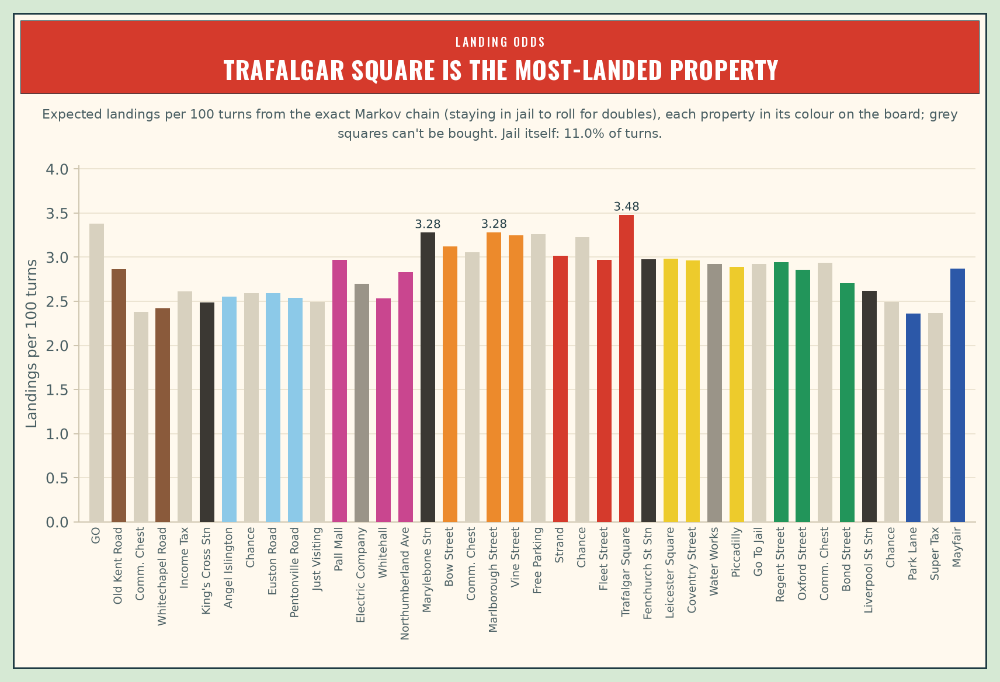

# Monopoly Meta

**What's the best way to play Monopoly? This project has computers play millions of games of classic UK Monopoly,
at every table size from 2 to 6 players, to find out.**



## The idea

Monopoly looks like a game of luck, but every choice in it (buy or pass, how much to bid, when to build, whether to
trade, whether to pay your way out of jail) changes your chance of winning. Make one choice differently, play
thousands of games each way with the same dice, and you can measure exactly what that choice is worth. The project
does this in three steps:

1. **Exact odds.** Where the dice send you, worked out mathematically: how often every square gets landed on.
2. **A full game simulator.** Every official rule (auctions, mortgages, the 32 houses and 12 hotels in the box, jail,
   bankruptcy), with computer players of different styles, fast enough to play millions of games.
3. **Computer players that learn.** Players evolved by playing each other, at every table size, until they were hard
   to beat. Then searches for strategies that beat *them*, and another round of learning.

## What it found

1. **Trafalgar Square is the most-visited property, Park Lane the least** (3.48 and 2.36 landings per 100 turns).
2. **The orange set is the best investment.** With hotels it pays for itself fastest: in about 7 rounds of play at
   4 players. On every set but the browns, the third house earns the most rent for its price.
3. **The last piece of a set is worth far more than its price.** In a test game at 4 players, a player who owns two
   of the oranges wins 6% of the time without the third, and 90% if given it. Compared with never getting it, it's
   worth up to £1,144 to them: almost six times the £200 printed on the card.
4. **Trading is most of the game.** With 3 or more players, a strong player that refuses every trade wins far less
   often: a fifth as often at 4 players. With 2 players, trading barely matters.
5. **Going first helps, and more so at a big table.** At 6 players the first player wins 20% more often than an
   equal share, and the last player 19% less.
6. **Don't sit on cash.** For the strongest players found, keeping £200 more in hand costs 10–19% of their wins.
7. **No strategy is unbeatable.** Every one of the strongest players found can be beaten by a counter-strategy,
   which scores 3% to 51% more against them. The best way to play depends on who you're playing against.

## How we know it's right

- **Same dice, two choices.** Every comparison plays both options on identical dice rolls, so luck cancels out, and
  every number comes with its margin of error.
- **Checked against itself.** The exact odds match 10 million simulated turns to within 0.5%, and over 180 automated
  tests check every rule, and that the money, houses and cards always add up after every turn.
- **Numbers re-checked automatically.** A script recomputes over 100 of the figures quoted here and in the full
  findings from the raw results, so a stale or mistyped number fails the tests.
- **Independently reviewed, three times.** Three outside reviews of the methods scored them 72, 82 and 85 out of
  100. Every issue they raised was checked against the code, fixed, and the affected studies re-run.

These are results for computer players of one design, under these rules: a strong guide to good play, not proof of
perfect play.

## Read more

- **[The full findings](FINDINGS.md)**: all 18 results, with tables, charts and margins of error.
- [Rules](RULES.md): exactly which rules the simulator plays, and what it simplifies.
- [Roadmap](ROADMAP.md): what comes next, and what each review changed.
- [Running it](RUNNING.md): how every result is reproduced.

```bash
pip install -e ".[dev]"
pytest
make play     # play the computer players yourself, in your browser
```

---

An independent, unofficial analysis for learning and research. Not affiliated with or endorsed by Hasbro. MONOPOLY
is a trademark of Hasbro; board names, prices and card texts are used only to model the game. Code: [MIT](LICENSE);
the Oswald font in the charts: SIL Open Font Licence 1.1.
